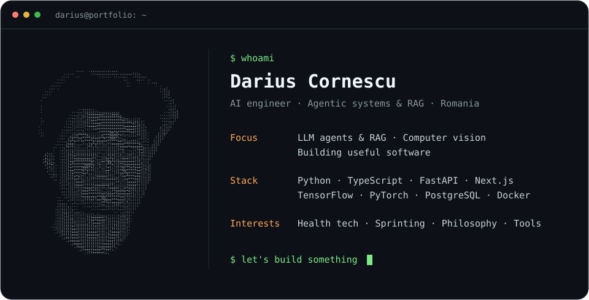

  

I'm an AI engineer in Romania, building agentic and retrieval-based systems at work and applied machine learning projects on the side. I'm doing an MSc in Artificial Intelligence at the University of Bucharest, after a BSc in AI at Babeș-Bolyai University.

### Selected projects

| Project | What it is |
| :--- | :--- |
| [DermaLens](https://github.com/DariusCornescu/DermaLens) | Skin lesion classifier that shows *why* it made each prediction with Grad-CAM heatmaps. Includes a study of four CNN architectures on ISIC data. TensorFlow, FastAPI, Next.js. |
| [Intent Qualification](https://github.com/DariusCornescu/Intent-Qualification-Verdion) | Natural-language company search for the Veridion challenge. Turns a query into filters, then ranks companies with BM25, embeddings and LLM reasoning, going only as deep as each query needs. |
| [Crux](https://github.com/DariusCornescu/Crux) | Training analytics app for sprint, endurance and mountaineering work. Syncs Strava and Spotify, and writes weekly LLM reports. FastAPI backend, Kotlin Android app. |
| [Flick](https://github.com/DariusCornescu/Flick) | Windows tray app that rewrites any selected text with one hotkey, using a local Ollama model or the Anthropic API. Supports Romanian and English. |
| [Mimesiss](https://github.com/DariusCornescu/WS-Mimesiss) | Workshop platform for registration, Stripe payments and QR-code check-in, with admin and moderator roles. Next.js, MongoDB, Clerk. |
| [House Price Prediction](https://github.com/DariusCornescu/House-price-prediction) | End-to-end ML project on the Ames housing data: cleaning, feature engineering, model comparison, and a deployed FastAPI + React price estimator. |

[University projects & coursework →](https://github.com/DariusCornescu/University-UBB-Artificial_Intelligence-Projects)
